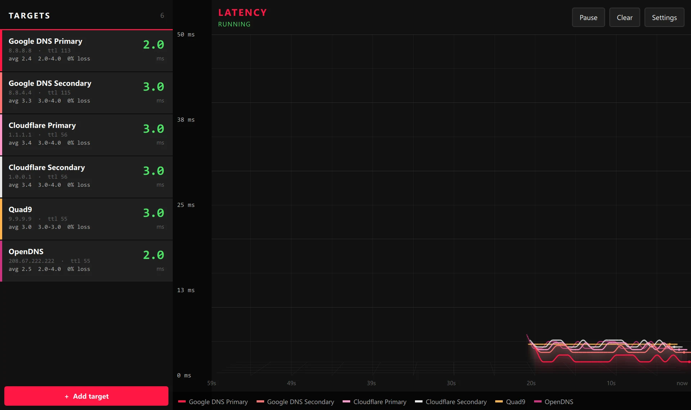

<div align="center">


# Pingy

**Multi-host ping, drawn as smooth live curves on a 3D perspective graph.**

[](https://github.com/lockewerks/Pingy-Native/releases)
[](LICENSE)
[](#requirements)

</div>

---



Pingy pings any number of hosts at once and shows each one's latency history as its own trace, stacked in depth. Each host gets live current, average, min/max and packet-loss figures beside it. Timeouts break the line and leave a red marker on the floor rather than drawing a dip to zero.

The graph is rendered on the GPU through Qt Quick's scene graph. Every sample sits at its own send time and the vertex shader maps time to position each frame, so the traces scroll at one constant speed however irregularly replies arrive. Curves are monotone cubics, so they never overshoot the data, and the latency scale glides to a new range instead of jumping.

## Install

Releases carry one package per platform:

| Platform | File | Notes |
|----------|------|-------|
| Windows 10 1809+ x64 | `Pingy-Setup-<ver>.exe` | Signed. Installs to `C:\Program Files\Pingy` with a Start Menu shortcut. |
| macOS 12+ Apple silicon | `Pingy-<ver>-arm64.dmg` | Signed and notarized. Drag to Applications. |
| Debian 13, Ubuntu 24.04+ | `pingy_<ver>_amd64.deb` | `sudo apt install ./pingy_<ver>_amd64.deb` |
| Fedora 41+ | `pingy-<ver>-1.x86_64.rpm` | `sudo dnf install ./pingy-<ver>-1.x86_64.rpm` |

Windows unattended install:

```batch
Pingy-Setup-<ver>.exe /S                          :: silent
Pingy-Setup-<ver>.exe /S /O:add_to_path=off       :: skip the PATH entry
Pingy-Setup-<ver>.exe /S /O:desktop_shortcut=on   :: add a desktop shortcut
```

### Requirements

- **Windows:** 10 version 1809 or later, x64. Pinging uses `IcmpSendEcho`, which needs no administrator rights.
- **macOS:** 12 or later on Apple silicon. macOS allows unprivileged ICMP sockets.
- **Linux:** x86_64 with Qt 6.4 or later from the distribution. The package grants `/usr/bin/pingy` the `cap_net_raw` capability at install, because distributions whose `net.ipv4.ping_group_range` excludes ordinary users refuse unprivileged ICMP sockets.

## Use

- **Add target:** a hostname or IP, with an optional display name.
- **Click a target** to pause or resume pinging it. Hover and click the cross to remove it.
- **Pause** stops all pinging and freezes the graph. **Clear** empties the history and stats, paused or not.
- **Settings:** ping interval, timeout, TTL and history length. Changes apply when a slider is released.

Settings and targets are saved as JSON:

| Platform | Path |
|----------|------|
| Windows | `%APPDATA%\Pingy\pingy_config.json` (the same file 1.x used, so targets carry over) |
| macOS | `~/Library/Application Support/com.Locke-Werks.Pingy/pingy_config.json` |
| Linux | `~/.config/pingy/pingy_config.json` |

`--config <path>` uses a different file. `--snapshot <file.png>` renders for 20 seconds, saves the window to the file and exits.

The defaults are Google DNS (both), Cloudflare (both), Quad9 and OpenDNS.

## Building

Needs Rust (stable) and Qt 6.4 or later with Qt Quick, Qt Quick Controls and, ideally, Qt Shader Tools. Point `QMAKE` at that Qt's `qmake`:

```sh
QMAKE=/path/to/Qt/6.8.3/<arch>/bin/qmake cargo build --release
cargo test --release
```

On Windows, build from a shell with the MSVC toolchain available, and put Qt's `bin` on `PATH` to run the binary or the tests from the build tree. `windeployqt --qmldir qml target/release/pingy.exe` produces a self-contained folder.

`build.rs` compiles `shaders/*.vert` and `*.frag` with the `qsb` that belongs to the Qt being built against. Without Qt Shader Tools it falls back to the committed `.qsb` files, which come from a recent `qsb` and may not load on older Qt releases.

### Layout

```
src/main.rs            app start, Qt engine, tokio runtime
src/engine.rs          shared state, one ping task per target, the shared clock
src/ping.rs            IcmpSendEcho on Windows, surge-ping on macOS and Linux
src/model.rs           per-target history ring and stats
src/config.rs          settings and targets, JSON
src/bridge.rs          the QObject QML talks to
src/graph_data.rs      what the graph item pulls from Rust each frame
src/latency_graph.*    the scene-graph item: tessellation, perspective, grid
shaders/               trace vertex and fragment shaders
qml/                   the UI
packaging/             Linux desktop entry and install scripts, macOS bundle files
installer.toml         Windows installer (Forge)
```

### Versioning and CI

The version lives in `Cargo.toml`, `installer.toml` and `packaging/macos/Info.plist`. `scripts/Check-Metadata.ps1` checks that they agree, along with the AppUserModelID, and CI runs it on every push. Every push to `master` builds and tests on Windows, Ubuntu and macOS. Pushing a `v*` tag that matches the version builds, signs and publishes all four packages. The Windows installer is built with [Forge](https://github.com/Locke-Werks/Forge) v0.4.1.

### History

1.x was a 66 KB Win32 executable with no C runtime, hand-rolled containers, polynomial trig and a hand-parsed JSON config. It lives in the git history up to `v1.0.2`. 2.0 is a rewrite in Rust and Qt 6 so it runs on more than one operating system.

## License

MIT. See [LICENSE](LICENSE).
